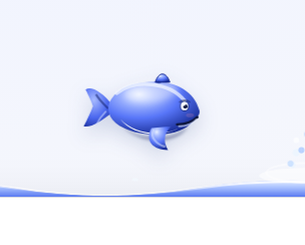
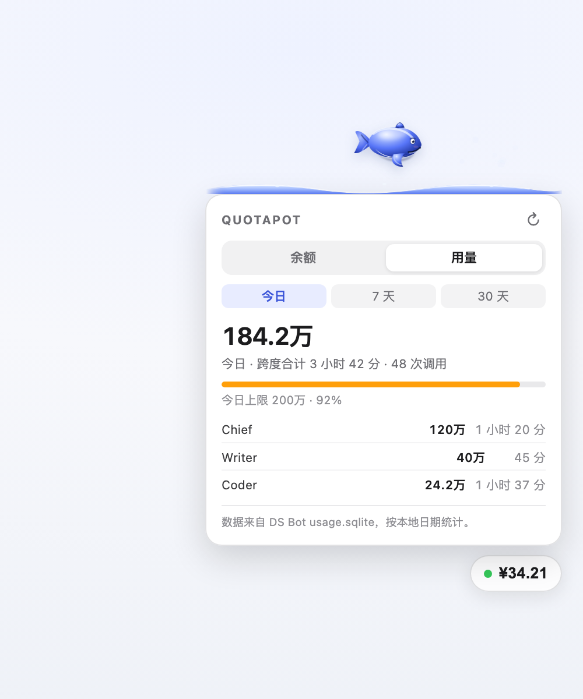

# QuotaPot

> A floating DeepSeek balance pill for DSH and DS Bot, with a low-balance warning.

QuotaPot is a [DeepSeek Harness](https://github.com/deepseek-ai/deepseek-harness) (DSH) plugin for **DSH Web, DS Bot Desktop and DS Bot Web**. It shows a draggable balance pill in the corner of the window, backed by DeepSeek's official `GET /user/balance` endpoint.


*Illustrative screenshot with sample data.*

## Features

- **Always visible** — a draggable pill in a corner; its position is remembered
- **Auto refresh** — every 30 seconds by default, and when the window regains focus
- **Top-up / granted split** — open the pill for the breakdown and update time
- **Whale pet** — floats at the surface above the card; while a Bot turn runs it breaches out of the water in an arc, dives back, and spouts when it surfaces; no surfboard, click once for a single breach
- **Usage tab** — today / 7 days / 30 days, total and per-Bot tokens, session spans
- **Daily token limit** — the pill turns red and shows `LIMIT` past `dailyTokenLimit`
- **Low-balance warning** — the dot turns red and a `LOW` badge appears below the threshold
- **Multiple currencies** — all currencies returned by the API are listed; CNY is preferred in the pill
- **Chinese and English** — automatic from the system language and time zone; force `zh` / `en` if needed
- **Zero dependencies, no build step** — just `index.js` and `widget.js`
- **The key never reaches the page** — only the host process reads it

## The whale



The whale is pure SVG: a radial gradient, specular highlight, ambient shadow, rim light and contact shadow give it volume, with no image assets. While a Bot turn runs it breaches out of the water, rotates, and dives back with a splash; it floats at the surface and spouts between breaches. The wave is card-width and sits above the card's top edge.

## Install

> Requires DSH `0.2.0-rc.2` or newer and Node `22.19+`.

### 1. DSH Plugins page (recommended)

Open **Settings → Plugins → Add plugin**, then enter:

```text
github:Caffrey-Li/dsh-bot-QuotaPot#v0.3.2
```

After the npm release is published, you can use the package name instead:

```text
dsh-bot-quotapot
```

Restart DSH completely if it says the change takes effect at the next start.

### 2. CLI (DSH Web profile)

```sh
npx @deepseek-ai/dsh@0.2.0-rc.2 plugin --profile web add github:Caffrey-Li/dsh-bot-QuotaPot#v0.3.2
npx @deepseek-ai/dsh@0.2.0-rc.2 web
```

> The Desktop profile is managed exclusively by the desktop app; use the Plugins page there.

### 3. Offline `.tgz`

Download `dsh-bot-quotapot-0.3.2.tgz` from [Releases](https://github.com/Caffrey-Li/dsh-bot-QuotaPot/releases) and install it from the Plugins page.

## Configuration

Everything is optional. Add this to the profile's `cordis.patch.yml`:

```yaml
- id: quotapot
  config:
    apiKeyEnv: DEEPSEEK_API_KEY
    baseUrl: https://api.deepseek.com
    refreshSeconds: 30
    lowBalanceThreshold: 5
    dailyTokenLimit: 2000000
    diskThresholdGB: 3
    position: bottom-right
    locale: auto
```

| Field | Default | Meaning |
|---|---|---|
| `apiKeyEnv` | `DEEPSEEK_API_KEY` | Environment variable holding the key |
| `baseUrl` | `https://api.deepseek.com` | Custom gateway/proxy; a trailing slash is fine |
| `refreshSeconds` | `30` | Poll interval, clamped to 10–600 seconds |
| `lowBalanceThreshold` | `5` | Warn below this amount; `0` disables it |
| `dailyTokenLimit` | `0` | Daily token cap (cache included); `0` disables it |
| `diskThresholdGB` | `3` | Threshold (GB) used for the "over" tag in the Space tab |
| `position` | `bottom-right` | `bottom-right` / `bottom-left` / `top-right` / `top-left` |
| `locale` | `auto` | `auto` uses the system language/time zone (Chinese zone or Chinese system → Chinese, else English); or force `zh` / `en` |

## Usage and limits

Open the pill → **Usage** tab:

- **Today / 7 days / 30 days**
- Total tokens for all Bots, plus each Bot's tokens and **session span**
- Session span = last call minus first call for that Bot in the range, **idle time included**
- `dailyTokenLimit` is checked against today's total: `input + cache_read + cache_write + output`
- Past the limit, the pill turns red, shows `LIMIT`, and the Usage tab explains

The data comes from `~/.dsh/bot/usage.sqlite` (DS Bot's own usage ledger, **read-only**). If the database is missing, the tab says there is no usage data. Cache reads count toward the total, so the number is usually much larger than input + output.



## Where the API key comes from

In order:

1. The environment variable named by `apiKeyEnv` (default `DEEPSEEK_API_KEY`)
2. DSH's credential service (`ctx.credentials`, supports rotation and the OS keychain)
3. `refs.DEEPSEEK_API_KEY` in `~/.dsh/.credentials.yaml`

If DeepSeek is already configured under **Settings → Models**, you usually do not need to add anything.

## Security

- `/quotapot/balance` and `/quotapot/usage` require a per-process random token injected into the page; no token, no data
- The API key never appears in the page, a response, or a log
- The only outbound request is `GET {baseUrl}/user/balance`
- The server still listens on `127.0.0.1` only; if you expose DSH on a LAN, the widget is exposed with the rest of the UI

## Compatibility

| Item | Version |
|---|---|
| DSH Web / Desktop | tested with `0.2.0-rc.2` and `0.2.1-rc.2` |
| DS Bot | 0.1.x / 0.2.x (as a host plugin) |
| Node.js | `>=22.19.0` |
| Platforms | macOS / Windows / Linux |
| Usage data | DS Bot 0.2.x `usage.sqlite`; may break if the schema changes |

## Troubleshooting

**No pill**

1. Hard refresh (`Cmd/Ctrl + Shift + R`)
2. Check the plugin is enabled under Settings → Plugins
3. `GET /quotapot/widget.js` should return JavaScript; a 404 means the host plugin did not load — restart DSH

**`Balance --` / `NO_KEY`**

No key was found. Set `DEEPSEEK_API_KEY`, or configure DeepSeek under Settings → Models.

**`API key rejected or expired`**

The key was refused. Check it and the account status on the DeepSeek platform.

**`Reload the page and try again` after a DSH restart**

The process token changed. Reload the page.

**The Usage tab is empty**

DS Bot has not written `usage.sqlite` yet, or Node lacks `node:sqlite` (needs 22.19+). Chat a few turns first; if it stays empty, check that `~/.dsh/bot/usage.sqlite` exists.

**Another balance plugin is installed**

Routes and globals are namespaced with `quotapot`, so they do not collide. If both pills show, remove one.

## Development

```sh
node --check index.js
node --check widget.js
npm test
```

No runtime dependencies; tests use Node's built-in `node:test`.

## Uninstall

Settings → Plugins → disable or remove QuotaPot. The plugin stores no business data.

## License

MIT. QuotaPot is an independent community project, not an official DeepSeek product. DeepSeek is a trademark of its owner.
