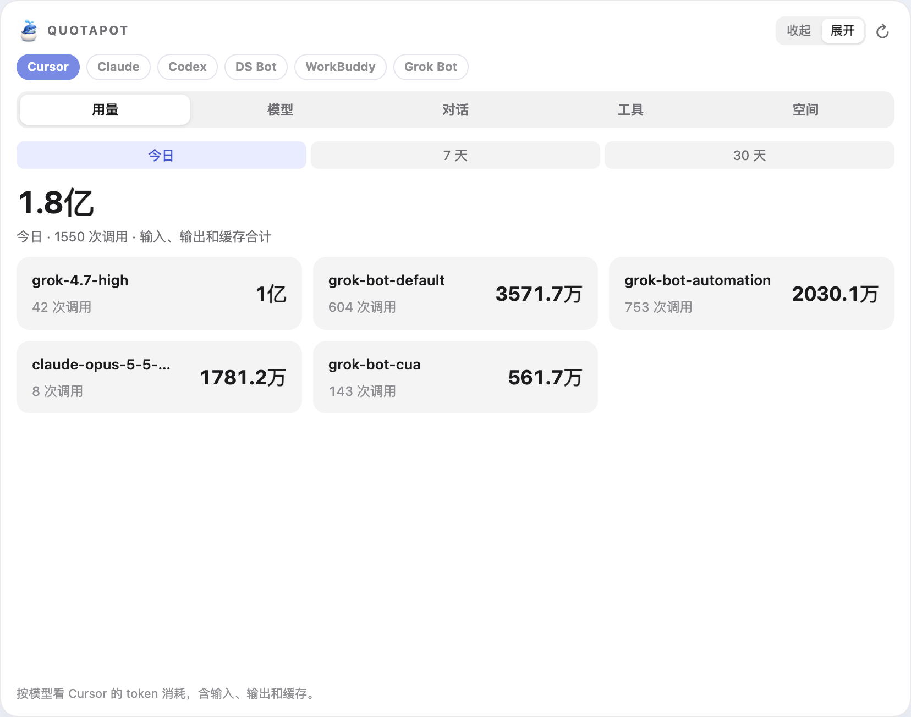
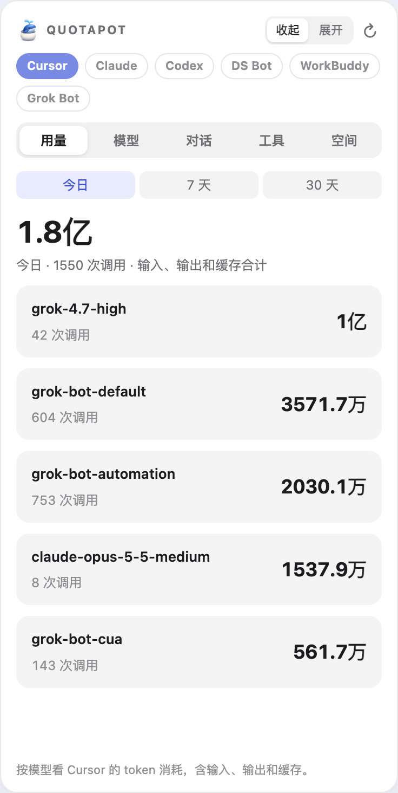
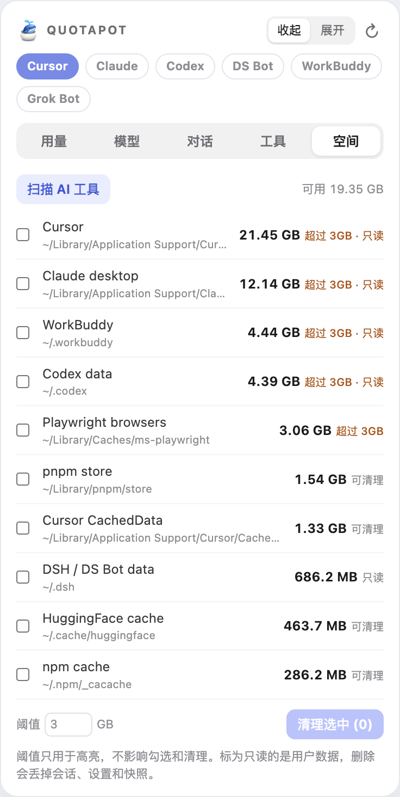

# QuotaPot

> AI 编程对话的上下文和额度管家：对话快满了提醒你整理交接，额度和用量一眼看清，顺手清理本机 AI 工具的缓存。Mac 和 Windows 都能用。

<p align="center"></p>

## DeepSeek Harness 插件

在 DSH 侧栏点击 **QuotaPot** 可打开对话、用量和空间面板。用量端口继续使用 QuotaPot 原有的数据源。DS Bot 的 token 统计来自 `DSH_HOME/bot/usage.sqlite`（默认 `~/.dsh/bot/usage.sqlite`）。DeepSeek API 余额需要可用的 API Key。插件使用 DSH 自带运行时和插件管理器。

### 安装

- **Windows** 解压 [dsh-quotapot-0.6.1.zip](https://caffrey-li.github.io/QuotaPot/dsh/dsh-quotapot-0.6.1.zip) 到固定目录。在 DSH 的「设置 → 插件 → 新增插件」选择解压后的 `dsh-quotapot-0.6.1` 文件夹。
- **macOS** 在同一入口选择 [dsh-quotapot-0.6.1.tgz](https://caffrey-li.github.io/QuotaPot/dsh/dsh-quotapot-0.6.1.tgz)，也可以选择解压后的文件夹。
- **固定地址** 在「新增插件」粘贴 `https://caffrey-li.github.io/QuotaPot/dsh/latest.tgz`。DSH 提示重启时，重启后再打开侧栏面板。

### 更新

如果 `0.6.0` 在 DSH 插件管理页显示「异常」，请先从该页移除旧 QuotaPot 插件，再添加上面的 `0.6.1` 包并重启 DSH。

打开侧栏的 QuotaPot，点击「检查更新」。出现新版本提示后点击「立即更新」，由 DSH 插件管理器安装。面板会提示是否需要重启 DSH。更新渠道使用 `latest.json` 检查版本，使用清单中对应的版本化 `.tgz` 安装。

维护者可运行 `npm run pack:dsh -- <产物目录>` 生成版本包、Windows ZIP 和更新渠道文件。将版本化 `.tgz` 与 `latest.tgz` 放到本仓库 GitHub Pages 的 `/dsh/` 后，再上传 `latest.json`。同一版本的版本化包应保持原样。

## 桌面版

一个独立小窗口，支持 **Cursor、Claude Code、Codex、DS Bot（DeepSeek Harness）、WorkBuddy**。电脑上装了哪个，窗口里就出现哪个，点端口按钮切换。每个工具只显示它真正读得到的内容，读不到的部分不显示。

三个页面：

- **对话**：每个对话的上下文占用、压缩次数、消耗和耗时；超过 80% 提醒整理后开新对话。底部的「提示词」里有新对话、整理、崩溃后开新三条提示词，按工具自动换成 AGENTS.md / CLAUDE.md / CODEBUDDY.md。
- **用量**：顶部是读得到的额度（Cursor 本账期百分比、Codex 5 小时 / 7 天窗口、DS Bot 余额），Cursor 有模型降级或停用时在这里提醒；下面是今日 / 7 天 / 30 天按模型的 token（WorkBuddy 为积分）。
- **空间**：扫描整台电脑上 AI 工具和开发缓存占用的磁盘，按工具分组，缓存挂在各自的数据目录下面。自定义高亮阈值，勾选后两步确认清理。

各工具能做到的：

| 工具 | 对话 | 整理和继承 | 用量 | 额度 |
| --- | --- | --- | --- | --- |
| Cursor | ✓，点对话条可跳转 | 写进对话输入框，可一键开新 | token | 本账期百分比 |
| Claude Code | ✓ | 复制后手动粘贴 | token | — |
| Codex | ✓ | 复制后手动粘贴 | token | 5 小时 / 7 天窗口 |
| WorkBuddy | ✓，点对话条可跳转 | 复制后手动粘贴 | 积分 | — |
| DS Bot | — | — | token | 余额（需要 DeepSeek API Key） |

- 窗口可在「收起」（竖条）和「展开」之间切换。Mac 的菜单栏有一只白色小鲸鱼。
- Mac 上有新版本时，窗口顶部会提示，点「更新」自动下载、检查并重启。

Windows 上三个页面都能用，Cursor 的整理也会写进对应对话。菜单栏没有小鲸鱼，也不能点击对话条跳转。

### 截图

| 对话 | 用量 | 空间 |
| :---: | :---: | :---: |
|  |  |  |

<sub>截图来自 Mac，为收起状态（竖条）。对话标题已替换为示例。</sub>

### 安装

1. 准备：[Node.js](https://nodejs.org) 22.5 或更新。Mac 需要 macOS 13 或更新，并在「终端」运行 `xcode-select --install`（已经装过就跳过）。Windows 需要 Windows 10 或更新，并装好 Edge 或 Chrome。
2. 到[下载页](https://github.com/Caffrey-Li/QuotaPot/releases/latest)下载 `QuotaPot.zip` 并解压，得到 `quotapot` 文件夹。
3. Mac 打开「终端」，Windows 打开「命令提示符」。输入 `cd `（后面带一个空格），把 `quotapot` 文件夹拖进窗口，回车。
4. 运行下面这行：

   ```sh
   node desktop.mjs --install
   ```

Mac 上 QuotaPot 会出现在「应用程序」里，并自动打开。第一次点对话条跳转 Cursor 时，到「系统设置 → 隐私与安全性 → 辅助功能」里打开 QuotaPot。

Windows 上桌面会多一个 `QuotaPot.cmd`。以后双击它就会打开窗口。

装好后不要移动或删除 `quotapot` 文件夹，程序运行时要用到它。「空间」页里标为只读的是用户数据，删除后会丢失会话、设置和快照。

## License

MIT。QuotaPot 是独立社区项目，与 Cursor、Anthropic、OpenAI、DeepSeek、腾讯、xAI 均无官方关系。
