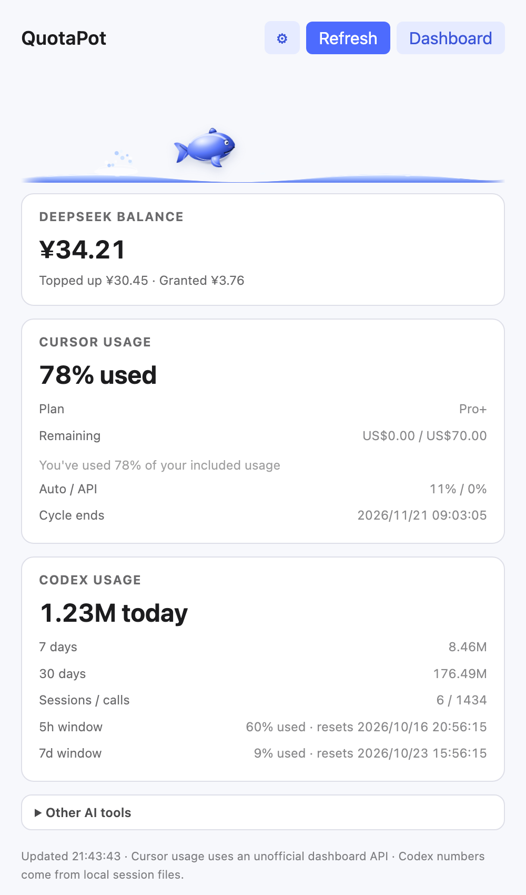
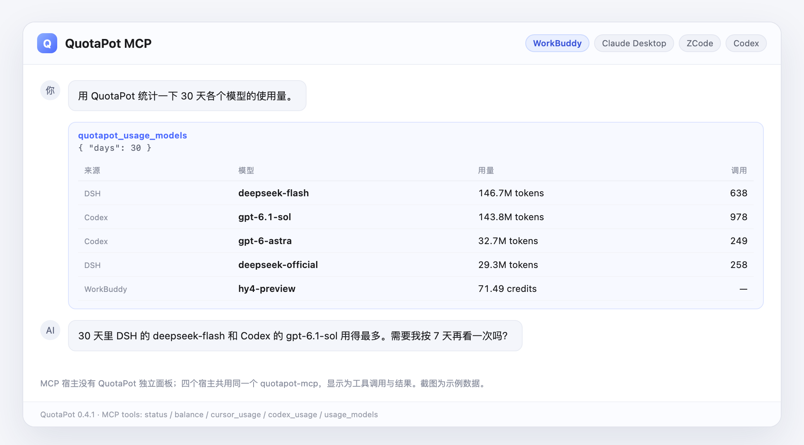

# QuotaPot

> 在 Cursor 旁边常驻的小窗口：AI 工具用量、模型状态、对话上下文、磁盘空间，一眼看清。

## Mac 桌面版（推荐）

一个独立的 Mac 小窗口，支持 **Cursor、Claude、Codex、DS Bot（DeepSeek Harness）、WorkBuddy、Grok Bot**。电脑上装了哪个，窗口里就出现哪个，点顶部按钮切换。

- **用量**：今日 / 7 天 / 30 天的调用次数和 token（WorkBuddy 为积分），按模型分卡片显示。
- **模型**：各模型状态、速度和出错时的中文说明。
- **对话**：每个对话的上下文占用、消耗和耗时；超过 80% 提醒开新对话，可一键整理、继承或开新。
- **工具**：交接、开新、整理用的提示词，按不同工具（AGENTS.md / CLAUDE.md / CODEBUDDY.md）自动调整，一键复制。
- **空间**：扫描各 AI 工具占用的磁盘，自定义高亮阈值，勾选后两步确认清理。
- 窗口可在「收起」（竖条）和「展开」之间切换；菜单栏有一只白色小鲸鱼。

### 安装

1. 准备：macOS 13 或更新；[Node.js](https://nodejs.org) 22.5 或更新；在「终端」运行 `xcode-select --install` 安装苹果命令行工具（已装过可跳过）。
2. 到 [v0.5.0 下载页](https://github.com/Caffrey-Li/QuotaPot/releases/tag/v0.5.0) 下载压缩包并解压，得到 `quotapot` 文件夹。
3. 打开「终端」，输入 `cd `（后面带一个空格），把 `quotapot` 文件夹拖进终端窗口，回车。
4. 运行下面这行，等 QuotaPot 自动打开：

   ```sh
   node desktop.mjs --install
   ```

装好后 QuotaPot 会出现在「应用程序」里。不要移动或删除 `quotapot` 文件夹，程序运行时要用到它。第一次点对话条跳转 Cursor 时，到「系统设置 → 隐私与安全性 → 辅助功能」里打开 QuotaPot。

---

## 旧版插件（v0.4.1）

> DeepSeek 余额、Cursor / Codex / WorkBuddy / ZCode 用量，加上一只小鲸鱼。  
> 三种安装形态：DSH 插件、Cursor/VS Code 扩展、MCP 插件。

<p align="center">
  <a href="docs/screenshot.png"></a>
  <a href="docs/screenshot-cursor.png"></a>
</p>
<p align="center"><sub>DSH 网页胶囊 · Cursor 侧栏（扩展 webview）</sub></p>

<p align="center">
  <a href="docs/screenshot-mcp.png"></a>
</p>
<p align="center"><sub>WorkBuddy / Claude Desktop / ZCode / Codex：同一个 MCP 工具返回，没有独立面板</sub></p>
<p align="center"><sub>截图使用示例数据</sub></p>

## 功能

- **DSH / DS Bot**：余额胶囊、今日/7天/30天用量、会话跨度、每日 token 阈值、低余额提醒、更新提示、磁盘空间监控、小鲸鱼。
- **Cursor / VS Code / 标准 Trae**：可折叠侧栏、状态栏、Cursor 用量、Codex 用量、其他 AI 工具、阈值设置、小鲸鱼。
- **WorkBuddy / Claude Desktop / ZCode / Codex**：MCP 插件，无独立 UI，五个工具。
- **按模型统计**：DSH、Codex、WorkBuddy 的模型级 token / credits。

## 安装

### DeepSeek Harness / DS Bot

设置 → 插件 → 添加插件，填：

```text
github:Caffrey-Li/QuotaPot#v0.4.1
```

CLI、离线 `.tgz`、桌面端说明见 [配置文档](docs/CONFIG.md#安装补充)。

### Cursor / VS Code / 标准 Trae

下载并安装：

[quotapot-0.2.0.vsix](https://github.com/Caffrey-Li/QuotaPot/releases/download/v0.4.1/quotapot-0.2.0.vsix)

安装后执行 `Developer: Reload Window`。TRAE SOLO CN 不支持第三方 VSIX，需要标准 Trae IDE。

### WorkBuddy / Claude Desktop / ZCode / Codex

MCP server 直接跑，不需要 npm 发布：

```sh
npx -y --package https://github.com/Caffrey-Li/QuotaPot/releases/download/v0.4.1/dsh-bot-quotapot-mcp-0.4.1.tgz quotapot-mcp
```

各宿主配置模板在 [agents/templates](agents/templates)，完整说明在 [agents/README.md](agents/README.md)。

## MCP 工具

- `quotapot_status` — 余额 + 各宿主用量
- `quotapot_balance`
- `quotapot_cursor_usage`
- `quotapot_codex_usage`
- `quotapot_usage_models` — 按模型统计 today / 7d / 30d

## 配置

所有字段可选。常用：`lowBalanceThreshold`、`dailyTokenLimit`、`diskThresholdGB`（也能在空间页直接改）。

完整字段、API Key 来源、安全边界、兼容性和卸载方式见 **[docs/CONFIG.md](docs/CONFIG.md)**。

MCP 宿主的 DeepSeek Key：

```sh
mkdir -p ~/.quotapot
printf '{"deepseekApiKey":"sk-..."}\n' > ~/.quotapot/config.json
chmod 600 ~/.quotapot/config.json
```

## 限制

- Cursor 用量来自未公开的 `api2.cursor.sh`，可能失效。
- Codex 只统计本地写入 `token_count` 的会话。
- WorkBuddy 是 credits；ZCode 只有套餐资格；Claude/Trae 桌面版没有本地用量。

## 文档

- [配置、安全、兼容、开发、卸载](docs/CONFIG.md)
- [故障排查](docs/TROUBLESHOOTING.md)
- [多宿主插件说明](agents/README.md)
- [更新日志](CHANGELOG.md)

## License

MIT。QuotaPot 是独立社区项目，不是 DeepSeek 官方产品。
