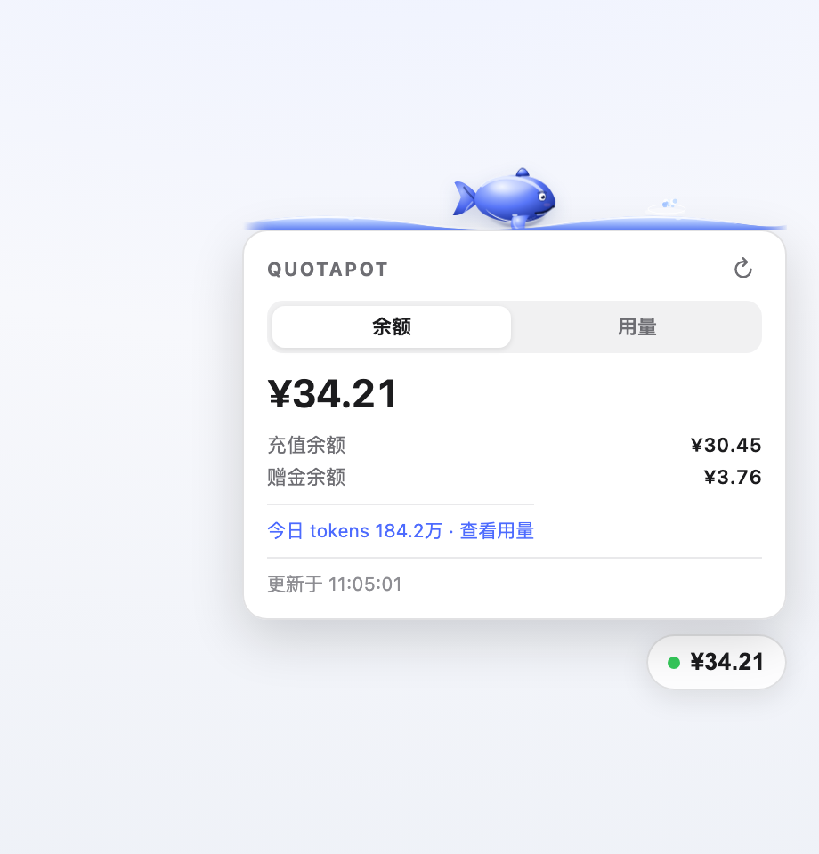

# QuotaPot

> DeepSeek 余额胶囊，常驻 DSH / DS Bot 窗口右下角。余额低了会提醒。

QuotaPot 是一个 [DeepSeek Harness](https://github.com/deepseek-ai/deepseek-harness)（DSH）插件，适用于 **DSH Web、DS Bot 桌面端和 Web 端**。它在界面角落显示一个可拖动的余额胶囊，数据来自 DeepSeek 官方 `GET /user/balance` 接口。



*界面示意，余额为示例数据。*

## 功能

- **常驻显示**：余额胶囊固定在窗口角落，可拖动，位置会记住
- **自动刷新**：默认每 30 秒拉一次余额，窗口重新获得焦点时也会刷新
- **充值/赠金拆分**：点开胶囊看充值余额、赠金余额和更新时间
- **低余额提醒**：低于阈值时胶囊变红并显示 `低`，面板给出提示
- **多币种**：官方返回多个币种时全部列出，胶囊优先显示 CNY
- **中英双语**：跟随浏览器语言，也可强制指定
- **零依赖、无构建**：没有 React、没有打包步骤，`index.js` + `widget.js` 两个文件
- **Key 不出宿主**：API Key 只在本机 Node 进程读取，浏览器只拿到余额

## 安装

> 需要 DSH `0.2.0-rc.2` 或更新版本，Node `22.19+`。

### 方式一：DSH 插件页面（推荐）

打开 **设置 → 插件 → 添加插件**，在“包名或地址”里填：

```text
github:Caffrey-Li/dsh-bot-QuotaPot#v0.1.0
```

或者，等 npm 发布后直接填包名：

```text
dsh-bot-quotapot
```

安装后如果 DSH 提示需要重启，完全退出再打开。

### 方式二：命令行（DSH Web profile）

```sh
npx @deepseek-ai/dsh@0.2.0-rc.2 plugin --profile web add github:Caffrey-Li/dsh-bot-QuotaPot#v0.1.0
npx @deepseek-ai/dsh@0.2.0-rc.2 web
```

> Desktop profile 由桌面 App 独占管理，命令行会拒绝；请用方式一。

### 方式三：离线 `.tgz`

从 [Releases](https://github.com/Caffrey-Li/dsh-bot-QuotaPot/releases) 下载 `dsh-bot-quotapot-0.1.0.tgz`，在插件页面选择本地文件安装。

## 配置

所有配置都可选。写进 profile 的 `cordis.patch.yml`：

```yaml
- id: quotapot
  config:
    apiKeyEnv: DEEPSEEK_API_KEY
    baseUrl: https://api.deepseek.com
    refreshSeconds: 30
    lowBalanceThreshold: 5
    position: bottom-right
    locale: auto
```

| 字段 | 默认 | 说明 |
|---|---|---|
| `apiKeyEnv` | `DEEPSEEK_API_KEY` | 读取 Key 的环境变量名 |
| `baseUrl` | `https://api.deepseek.com` | 自定义网关/代理地址，末尾斜杠可省略 |
| `refreshSeconds` | `30` | 轮询间隔，限制在 10–600 秒 |
| `lowBalanceThreshold` | `5` | 低于该金额时提醒；`0` 关闭 |
| `position` | `bottom-right` | `bottom-right` / `bottom-left` / `top-right` / `top-left` |
| `locale` | `auto` | `auto` / `zh` / `en` |

## API Key 从哪里来

按顺序尝试：

1. 环境变量 `apiKeyEnv`（默认 `DEEPSEEK_API_KEY`）
2. DSH 凭据存储（`ctx.credentials`，支持轮换和 keychain）
3. `~/.dsh/.credentials.yaml` 里 `refs.DEEPSEEK_API_KEY`

Key 需要能调用 DeepSeek 开放平台接口。如果你在 DSH 的 **设置 → 模型** 里已经配置了 DeepSeek，通常不需要再填。

## 安全

- 余额路由是 `/quotapot/balance`，只接受带**进程级随机 token** 的请求；token 由页面注入，不落盘
- 未授权请求返回 401，不返回余额
- API Key 不会出现在页面、响应或日志里
- 只向 `baseUrl` 的 `/user/balance` 发 GET 请求，没有遥测
- 和 DSH 一样只监听 `127.0.0.1`；如果你用手机前门把 DSH 暴露到局域网，余额也会随 UI 一起可见

## 兼容性

| 项目 | 版本 |
|---|---|
| DSH Web / Desktop | `0.2.0-rc.2`、`0.2.1-rc.2` 实测 |
| DS Bot | 0.1.x / 0.2.x（宿主插件形式） |
| Node.js | `>=22.19.0` |
| 平台 | macOS / Windows / Linux |

## 故障排查

**胶囊没出现**

1. 强制刷新页面（`Cmd/Ctrl + Shift + R`）
2. 确认插件已启用：设置 → 插件
3. 访问 `http://127.0.0.1:<port>/quotapot/widget.js`，应返回 JS；404 说明宿主插件没加载，重启 DSH

**显示 `余额 --` / `NO_KEY`**

没有找到 Key。检查 `DEEPSEEK_API_KEY`，或在 设置 → 模型 里配置 DeepSeek。

**显示 `API Key 无效或已过期`**

Key 被拒绝。到 DeepSeek 开放平台确认 Key 和余额状态。

**DSH 重启后显示 `请刷新页面`**

进程级 token 变了，刷新页面即可。

**同时装了别的余额插件**

路由和全局变量都带 `quotapot` 前缀，不会冲突；如果两个胶囊都显示，卸载其中一个即可。

## 开发

```sh
node --check index.js
node --check widget.js
npm test
```

本仓库没有运行时依赖，测试使用 Node 自带 `node:test`。

## 卸载

设置 → 插件 → 停用/移除 QuotaPot。插件不写业务数据，卸载后不会留下余额或 Key。

## License

MIT。QuotaPot 是独立社区项目，不是 DeepSeek 官方产品；DeepSeek 是其权利人的商标。
