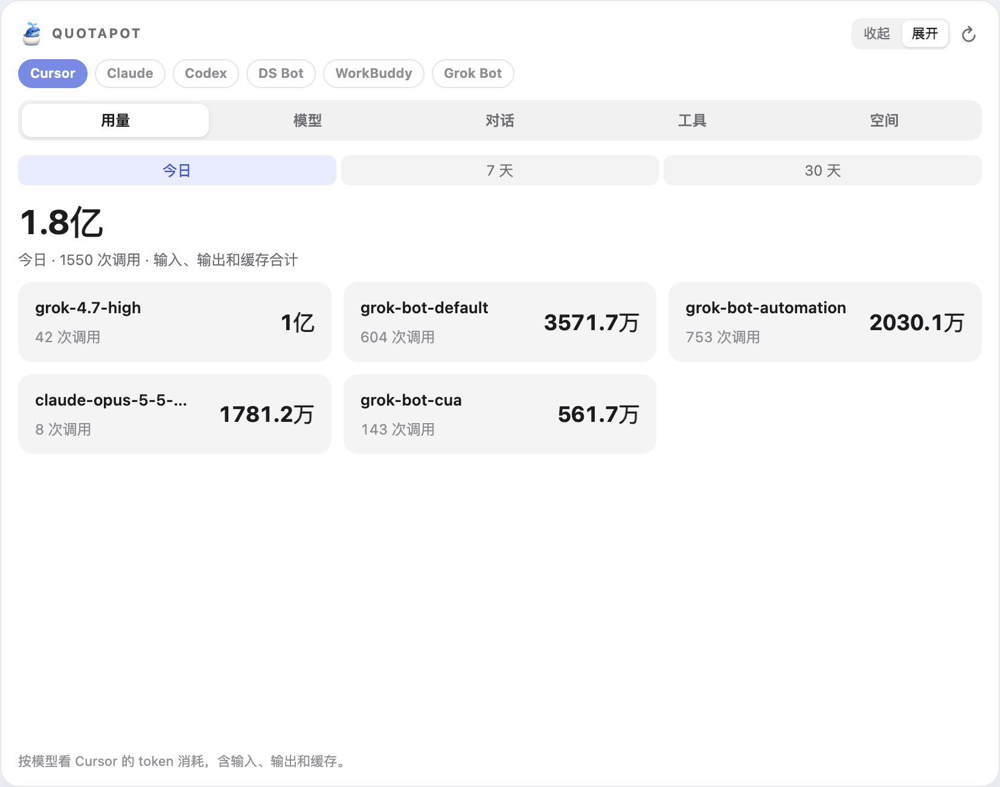
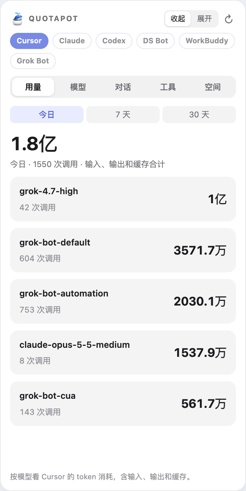
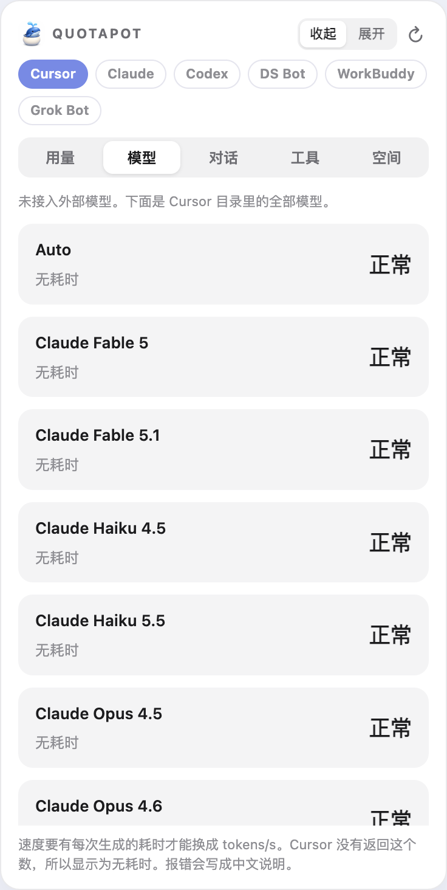
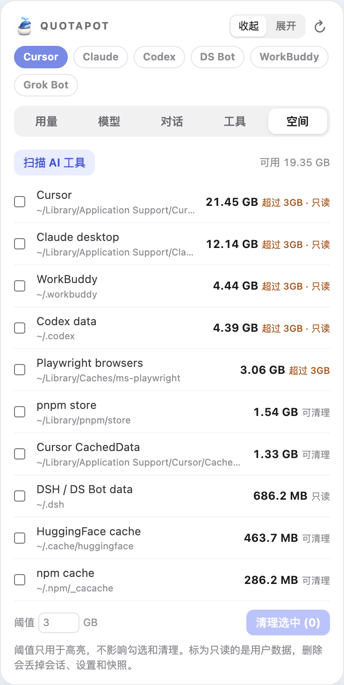

# QuotaPot

> 在 Cursor 旁边常驻的小窗口：AI 工具用量、模型状态、对话上下文、磁盘空间，一眼看清。

<p align="center"></p>

## Mac 桌面版

一个独立的 Mac 小窗口，支持 **Cursor、Claude、Codex、DS Bot（DeepSeek Harness）、WorkBuddy、Grok Bot**。电脑上装了哪个，窗口里就出现哪个，点顶部按钮切换。

- **用量**：今日 / 7 天 / 30 天的调用次数和 token（WorkBuddy 为积分），按模型分卡片显示。
- **模型**：各模型状态、速度和出错时的中文说明。
- **对话**：每个对话的上下文占用、消耗和耗时；超过 80% 提醒开新对话，可一键整理、继承或开新。
- **工具**：交接、开新、整理用的提示词，按不同工具（AGENTS.md / CLAUDE.md / CODEBUDDY.md）自动调整，一键复制。
- **空间**：扫描各 AI 工具占用的磁盘，自定义高亮阈值，勾选后两步确认清理。
- 窗口可在「收起」（竖条）和「展开」之间切换；菜单栏有一只白色小鲸鱼。
- 有新版本时窗口顶部会提示，点「更新」自动下载、检查并重启。

### 截图

| 用量 | 模型 | 对话 |
| :---: | :---: | :---: |
|  |  |  |
| **工具** | **空间** | |
|  |  | |

<sub>截图为收起状态（竖条）。对话标题已替换为示例。</sub>

### 安装

1. 准备：macOS 13 或更新；[Node.js](https://nodejs.org) 22.5 或更新；在「终端」运行 `xcode-select --install` 安装苹果命令行工具（已装过可跳过）。
2. 到[下载页](https://github.com/Caffrey-Li/QuotaPot/releases/latest)下载 `QuotaPot-mac.zip` 并解压，得到 `quotapot` 文件夹。
3. 打开「终端」，输入 `cd `（后面带一个空格），把 `quotapot` 文件夹拖进终端窗口，回车。
4. 运行下面这行，等 QuotaPot 自动打开：

   ```sh
   node desktop.mjs --install
   ```

装好后 QuotaPot 会出现在「应用程序」里。不要移动或删除 `quotapot` 文件夹，程序运行时要用到它。第一次点对话条跳转 Cursor 时，到「系统设置 → 隐私与安全性 → 辅助功能」里打开 QuotaPot。

## License

MIT。QuotaPot 是独立社区项目，与 Cursor、Anthropic、OpenAI、DeepSeek、腾讯、xAI 均无官方关系。
