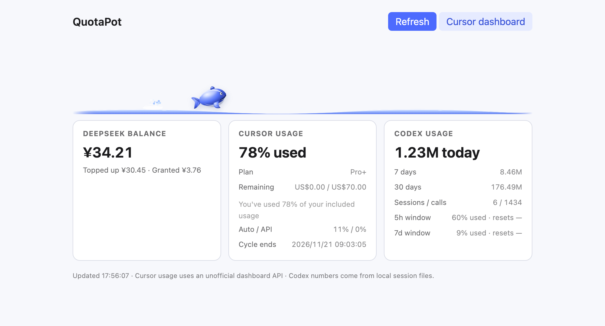

# QuotaPot multi-host plugins

QuotaPot ships three installable forms from one repository:

| Host | Form | Entry |
|---|---|---|
| DeepSeek Harness / DS Bot | web pill + whale | repository root package |
| Cursor / VS Code / standard Trae | VS Code extension | `quotapot-0.2.0.vsix` release asset |
| WorkBuddy / Claude Desktop / ZCode / Codex | MCP server | `agents/mcp`, or `npx` |



## MCP server

Tools:

- `quotapot_status` — DeepSeek, Cursor, Codex, WorkBuddy, ZCode
- `quotapot_balance` — DeepSeek
- `quotapot_cursor_usage` — Cursor billing period
- `quotapot_codex_usage` — Codex tokens and rate limits
- `quotapot_usage_models` — per-model tokens/credits for today / 7d / 30d

The server is `agents/mcp/server.cjs`. The portable command used by all templates is:

```sh
npx -y --package github:Caffrey-Li/dsh-bot-QuotaPot#v0.4.0 quotapot-mcp
```

First launch downloads the package. If the host has a short MCP startup timeout, set it to 60 seconds. Offline users can clone the repo and run `node /ABSOLUTE/PATH/agents/mcp/server.cjs`.

### WorkBuddy

Merge `templates/workbuddy.json` into `~/.workbuddy/mcp.json`, restart WorkBuddy, then click **Trust** on the new connector.

### Claude Desktop

Merge `templates/claude.json` into `claude_desktop_config.json` and restart Claude. Claude Code is not installed by this package; the same MCP server can be added to its `.mcp.json` if you use the CLI.

### ZCode

`templates/zcode/` contains `.zcode-plugin/plugin.json`, `.mcp.json` and a marketplace entry. Copy the plugin into a plugin cache directory, set `__PLUGIN_DIR__` in the marketplace to that absolute directory, restart ZCode and enable QuotaPot from the plugin page.

### Codex

`templates/codex/.mcp.json` is the plugin manifest. Codex also supports a local marketplace; see `codex-marketplace/` in this repository. Restart Codex after enabling it.

## Cursor / VS Code / standard Trae

Download `quotapot-0.2.0.vsix` from the release and install it with your editor's **Install from VSIX**. In Cursor it adds the compact side bar, status bar, whale, thresholds and the Other AI tools section. In a VS Code-compatible host it hides the Cursor-only usage card.

**TRAE SOLO CN** is not a compatible host: its CLI rejects third-party VSIX files (`ScanningExtension`), even an empty minimal VSIX. Use a standard Trae IDE / VS Code build instead.

## DeepSeek key

Create the private file once:

```sh
mkdir -p ~/.quotapot
printf '{"deepseekApiKey":"sk-..."}\n' > ~/.quotapot/config.json
chmod 600 ~/.quotapot/config.json
```

The Cursor extension uses SecretStorage first and falls back to this file.

## Per-model data

`quotapot_usage_models` reads:

- DSH `~/.dsh/bot/usage.sqlite` — provider/model tokens
- Codex `~/.codex/sessions/**/*.jsonl` — `turn_context.model` tokens
- WorkBuddy `~/.workbuddy/workbuddy.db` — credits by `sessions.model`

Cursor has no model-level granularity. ZCode, Claude Desktop and Trae have no local token usage.

## Limits

- Cursor usage uses the undocumented `api2.cursor.sh` dashboard API.
- Codex only counts sessions that record `token_count`; "today" can be 0.
- WorkBuddy exposes credits, not tokens.
- ZCode exposes plan entitlement only.
- Claude Desktop and Trae have no local token/quota API.
